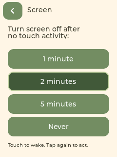

# 宠物需求规则与自动熄屏

宠物状态由照顾记录与作息计算，替代此前每约 30 秒随机切换需求。数据保存在设备本地，金币扣款仍由真实服务端处理。本次无需执行 SQL 或部署家长端。

## 小二哈的默认规则

以成年家犬的家庭作息作为首版模拟参数，使用北京时间（UTC+8）。

| 项目 | 规则 |
| --- | --- |
| 进食 | 每天 07:30、18:30 为进食时间；上一次进食距今至少 6 小时，且最近一餐尚未满足，才表现饥饿。错过饭点后需求仍保留，不会因为饭点过去就自行开心。 |
| 饮水 | 距上次成功喝水至少 2 小时后可表现口渴；喝水后重新计时。 |
| 陪伴 | 距上次陪伴至少 4 小时后可表现想陪伴；免费 Pet 或成功兑换陪伴类商品后重新计时。 |
| 夜间睡眠 | 22:00–次日 07:00。 |
| 白天小睡 | 10:30–11:30、13:00–15:00、17:00–18:00。每天合计睡眠 13 小时。 |
| 犯困 | 计划睡眠前 10 分钟表现困倦；存在饮水或进食需求时先显示这些需求，到睡眠时间后入睡。 |
| 手动 Sleep | 白天可以主动休息 45 分钟；结束后根据作息与尚未满足的需求继续表现。 |
| 手动 Wake | 暂时清醒 30 分钟，之后若仍在睡眠时段则继续睡觉。照顾互动也会给予 30 分钟清醒时间。 |

睡眠时不主动展示饥渴或孤独；醒来后会根据实际照顾间隔表现需求。需求没有扣币、生病或死亡惩罚。首次使用从需求已满足的状态开始。

多个需求同时存在时，表现顺序为：睡眠 → 口渴 → 饥饿 → 犯困 → 想陪伴 → 日常动作。照顾后先播放对应动作和开心动画，再回到实际状态。例如喂水缓解口渴，但如果还饿，开心动作结束后会表现饥饿；陪伴不会消除饥饿。任务奖励不改变照顾记录，后台审批也不会叫醒正在睡觉的小狗。

商品照顾效果沿用现有的动作映射：`eat` 为进食、`drink` 为饮水、`pet` 为陪伴、`happy` 仅庆祝。当前尚未区分正餐与零食的营养量，商品价格不会改变需求冷却时间。

## 保存、离线和时间

- 每次照顾或手动睡醒操作立即保存，平时每 5 分钟保存检查点；保存失败在后台重试。
- 已校时的记录在重启后会计入断电期间的时间；重复重启不会直接把已保存的照顾记录清零。
- 尚未获取可信时间时，按设备运行时间计算照顾间隔，不猜测几点睡觉。进食改用 8 小时的备用间隔，联网校时后恢复饭点规则。
- 校时期间刚发生的照顾不会被重启前的离线时间覆盖。系统时钟回退不会倒扣运行期间已经过去的冷却时间。
- 无时钟期间保存的记录保留已有间隔，但无法推算之后断电的时长，采用保守恢复。
- 在任务同步中发现设备更换了归属孩子时，新孩子的小宠从健康基线开始。照顾状态目前是设备本地数据，同一孩子的多台设备之间尚不共享。

## 自动熄屏

右上角 Settings → Screen，可以选择 **1 minute / 2 minutes / 5 minutes / Never**，默认 2 分钟。选项在设备重启后保留。



只以实际触摸活动重置计时。到时关闭背光并暂停宠物动画；任务、金币、购买重试、宠物作息和照顾时间仍继续处理。后台消息不会主动亮屏。

触摸屏幕后恢复原背光，完整吞掉唤醒的按下、拖动与抬起过程；松手后再点击，才能操作页面。因此点击黑屏不会直接购买原位置上的商品，也不会自动叫醒正在睡觉的宠物。此功能为关闭屏幕背光，设备仍保持联网运行。

## 新增动物与调整规则

每种动物单独维护一个 `apps/pet-device/pets/*.json` 文件，目前是 `husky.json`。可以独立定义饭点、最短进食间隔、饮水与陪伴间隔、多段睡眠、犯困提前量和手动睡醒时长。

修改后在仓库根目录执行：

```sh
python3 apps/pet-device/tools/generate_pet_profiles.py
```

此命令同时生成固件 `main/pet_profiles.c` 与浏览器 `preview/pet-profiles.js`，保证两个预览使用同一份动物参数。通用计算引擎不包含哈士奇的专属时间常量。新增动物后还需接入其动画和选择来源；本次设备仍使用小二哈，不新增动物选择界面。

## 本地验证

```sh
sh apps/pet-device/tools/behavior_check/run.sh
cmake -S apps/pet-device/tools/png_check -B /tmp/study-pet-png-check/build
cmake --build /tmp/study-pet-png-check/build --target check_settings -j 8
mkdir -p /tmp/study-pet-behavior-ui
/tmp/study-pet-png-check/build/check_settings /tmp/study-pet-behavior-ui
. ~/esp/esp-idf/export.sh
idf.py -C apps/pet-device build
```

自动测试覆盖独立照顾、饭点和冷却、跨午夜睡眠、小睡和手动唤醒、不同动物规则、全天睡眠总时长、无时钟/时钟回退、重启恢复、保存失败重试、熄屏配置保存、长按与唤醒触摸拦截；使用地址与未定义行为检查。

打开 `apps/pet-device/preview/index.html` 可以预览。外侧工具提供模拟时间快进、查看白天/夜间和模拟熄屏；只影响预览，不修改电脑时间。浏览器照顾状态为当前页面的模拟数据，设备实际照顾记录保存在 NVS。

本次固件构建和烧录完成，应用约 1.96 MiB，6 MiB 分区剩余约 67%。实机串口记录在启动后约 124.9 秒关闭背光（显示初始化后约 2 分钟），该观察期间未发现崩溃或 PNG 解码错误；当时未完成联网校时。浏览器与实际 LVGL 界面测试已验证 Screen 设置和唤醒触摸保护，实物触摸手感仍以实际设备操作为准。
