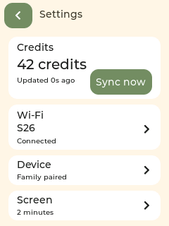
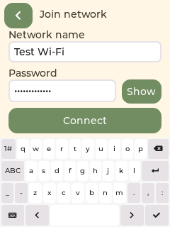

# 设备 Settings 与 Wi-Fi

首页右上角显示余额与齿轮，点击整个区域进入 Settings。首页持续显示 credit 数量，手动同步移入设置页。打开设置时暂停宠物动作，返回首页后继续。

| 区域 | 内容 |
| --- | --- |
| Credits | 当前余额、距上次同步的时间、`Sync now` 按钮；离线时标明缓存余额 |
| Wi-Fi | 当前网络名称与连接状态，点击后扫描或手动录入网络 |
| Device | 设备名称、固件版本、配对状态；未配对时提供家庭码输入入口 |
| Screen | 自动熄屏时间：1 / 2 / 5 分钟或 Never；默认 2 分钟，触摸唤醒 |

自动熄屏关闭背光，网络同步继续。第一次触摸仅亮屏，松手后再次点击才执行页面操作。宠物作息与照顾时间独立计算，详见 [宠物需求规则与自动熄屏](宠物需求规则与自动熄屏.md)。



## 更换网络

1. 点击首页右上角 → Settings → Wi-Fi。
2. 自动扫描附近 2.4GHz 网络，也可点 `Scan` 重新扫描。列表最多显示 12 个不同名称的网络，可上下滚动。
3. 点击网络名称；隐藏网络使用 `Manual` 手动输入名称。
4. 输入密码，用 `Show` / `Hide` 切换可见性。点击输入框切换键盘目标；键盘支持大小写、数字及符号。
5. 点击 `Connect` 或键盘确认键。连接期间可点 `Cancel` 或左上角返回取消。
6. 成功后点 `Back to Settings`；失败时点 `Try again`，重新输入密码。



没有任何配置的首次启动直接进入 Wi-Fi 引导。联网后，从 Settings → Device 输入 6 位家庭码，再去家长端为设备选择孩子。

Wi-Fi 成功以取得 IP 为准，互联网/API 是否可用由 Credits 同步状态反馈。支持开放网络及 WPA/WPA2/WPA3 个人密码网络；企业认证和 WEP 不在本版范围。网络名最长 32 字节，密码支持 8–63 字节或 64 位十六进制 PSK。中文网络名可通过扫描选择；设备键盘没有中文输入法。

## 保存与回退

- 连接由独立任务处理，不阻塞界面，也不被 HTTP 请求阻塞。
- 新网络取得 IP 后才提交到 NVS 的 `pet_wifi` 命名空间；日志不输出密码。
- 尝试约 25 秒超时；失败、取消或保存失败时恢复之前的配置并尝试重连。首次设置没有旧网络时，仍可重新录入。
- 重试不在输入框中保留刚输入的密码。已保存的设备配置优先于 `sdkconfig` 开发配置，后续换网无需重新编译或烧录。
- 配对、Wi-Fi 与待确认购买使用不同 NVS 命名空间；换网不清理家庭绑定或购买记录。

本次无需执行 SQL 或重新部署家长端/API。

## 验证与开发

实现：`apps/pet-device/main/settings_ui.c` 与 `wifi_manager.c`。前者只在 LVGL 主线程操作界面；后者管理扫描、连接、保存和回退，并提供线程安全的状态快照。

实际 LVGL 界面测试（需要已下载的 LVGL 组件、CMake 和本机 C 编译器）：

```bash
mkdir -p /tmp/study-pet-settings-check
cmake -S apps/pet-device/tools/png_check -B /tmp/study-pet-png-check/build
cmake --build /tmp/study-pet-png-check/build --target check_settings -j 8
/tmp/study-pet-png-check/build/check_settings /tmp/study-pet-settings-check
```

覆盖同步反馈、扫描列表、键盘位置及按键输入、输入框切换、密码显示与校验、取消/失败/重试/成功、配对入口及首次联网。PPM 截图来自实际 `settings_ui.c` 的 LVGL 渲染，网络状态使用模拟数据。

真实 Wi-Fi 管理代码的离线故障注入测试：

```bash
cc -std=c11 -Wall -Wextra \
  -I apps/pet-device/tools/wifi_check \
  -I apps/pet-device/tools/wifi_check/stubs \
  apps/pet-device/tools/wifi_check/check.c -o /tmp/study-pet-wifi-check
/tmp/study-pet-wifi-check
```

覆盖取得 IP 后才保存、NVS 重载、超时/取消/保存失败的回退（分别有旧配置和无旧配置）、尚未执行的连接请求取消、扫描去重。测试替代 ESP-IDF 驱动和 NVS，不使用真实密码或修改电脑网络。

`apps/pet-device/preview/index.html` 也已同步 Settings / Wi-Fi 流程，可用 VS Code 或浏览器预览；商品、余额和 Wi-Fi 都是模拟数据，不操作电脑网络。

固件已构建并烧录。启动观察 35 秒：显示初始化、原 Wi-Fi 连接及校时正常，真实 API 同步到 3 个商品，未观察到崩溃、PNG 解码或内存分配错误。实物触摸手感、扫描结果及切换其他真实路由器仍以设备实际使用为准。
